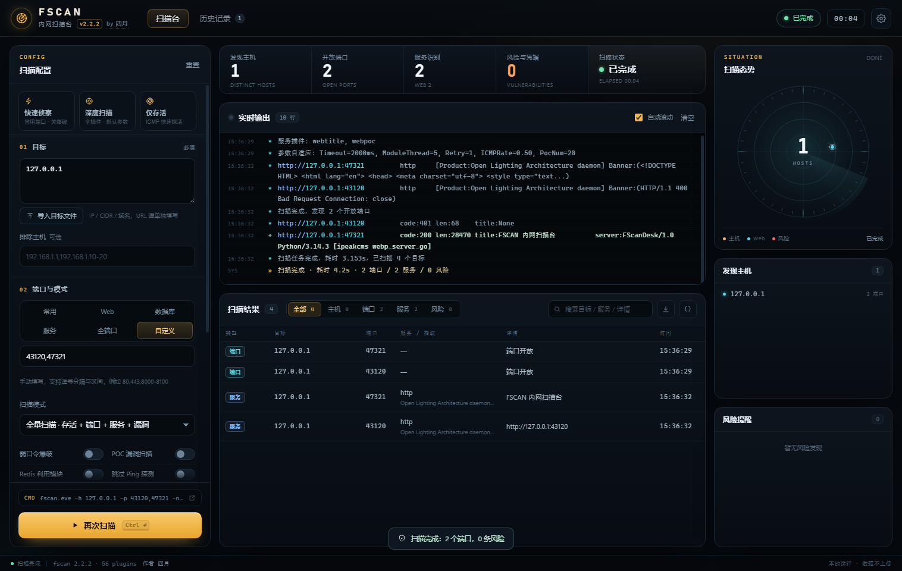

# FSCAN Console

> A local, zero-dependency GUI for [fscan](https://github.com/shadow1ng/fscan).
>
> **Author: [四月 (mcsiyue)](https://github.com/mcsiyue)**
>
> This is an unofficial GUI wrapper. Scanning, fingerprints and POCs come from
> [shadow1ng/fscan](https://github.com/shadow1ng/fscan); this repository only
> provides the interface, task orchestration, result presentation and history.



## Features

- Targets: IP / CIDR / domain / file import; full URLs switch to fscan's web scan mode
- Port presets: common, web, database, service, all ports, custom
- Modes: full, alive only, web only, selected plugins
- Toggles for brute force, POC, Redis exploitation, ICMP ping
- Concurrency, timeouts, POC concurrency, rate limit
- Credentials, NTLM hash, SSH key, HTTP / SOCKS5 proxy, interface binding
- Live console with severity colors and keyword highlighting
- Structured results: hosts, ports, services, risks; expandable raw JSON
- Radar overview, host list, risk list
- Local scan history, read-only history modal, CSV / JSON export
- Local-only HTTP API on `127.0.0.1` with a random token

## Quick start

Download the Windows release from [Releases](https://github.com/mcsiyue/fscan-console/releases), or run from source:

```bash
git clone https://github.com/mcsiyue/fscan-console.git
cd fscan-console
python scripts/fetch_fscan.py
python run.py
```

Requires Python 3.10+ and Edge or Chrome. Runtime Python dependencies: none.

Build the Windows executable:

```powershell
python -m pip install -r requirements-dev.txt
python scripts/fetch_fscan.py
powershell -ExecutionPolicy Bypass -File scripts/build.ps1
```

Output: `dist/FScanDesk.exe` and `release/fscan-console-v1.0.0-windows-x64.zip`.

## Data

`%LOCALAPPDATA%\FScanDesk` contains the copied fscan binary, scan history,
console logs and settings. Delete that folder to reset the app.

## Security

The server listens on loopback only and requires `X-FSCAN-Token` for every API
call except `/api/ping`. Use only against targets you are authorized to test.

## Credits & License

- Wrapper UI and orchestration: MIT © 2026 四月 (https://github.com/mcsiyue)
- fscan: MIT © 2021 shadow1ng — https://github.com/shadow1ng/fscan
- See `LICENSE`, `NOTICE`, and `third_party/fscan-LICENSE.txt`.
